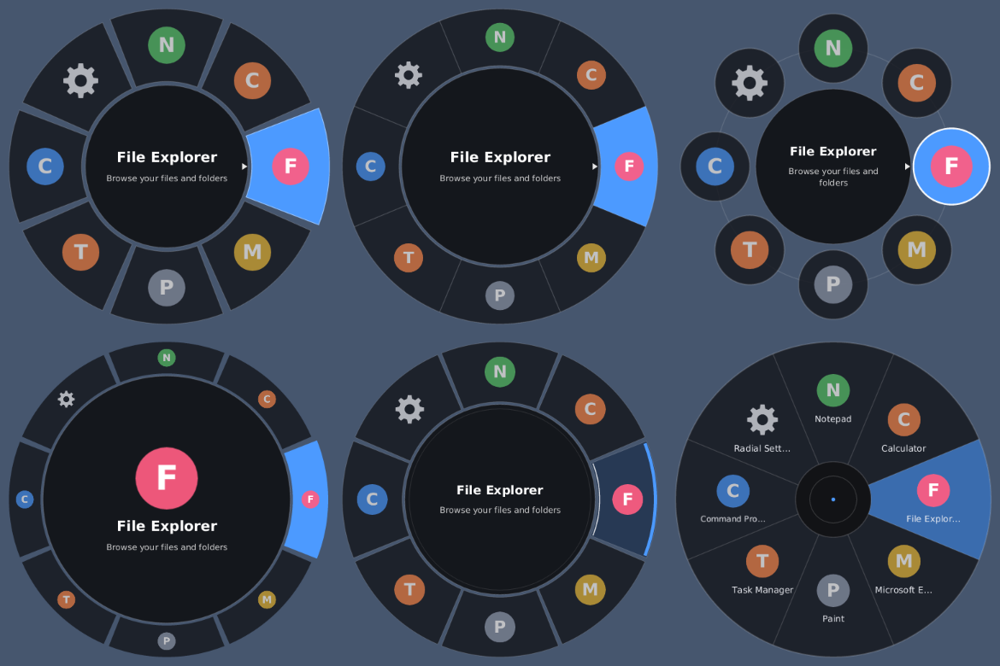
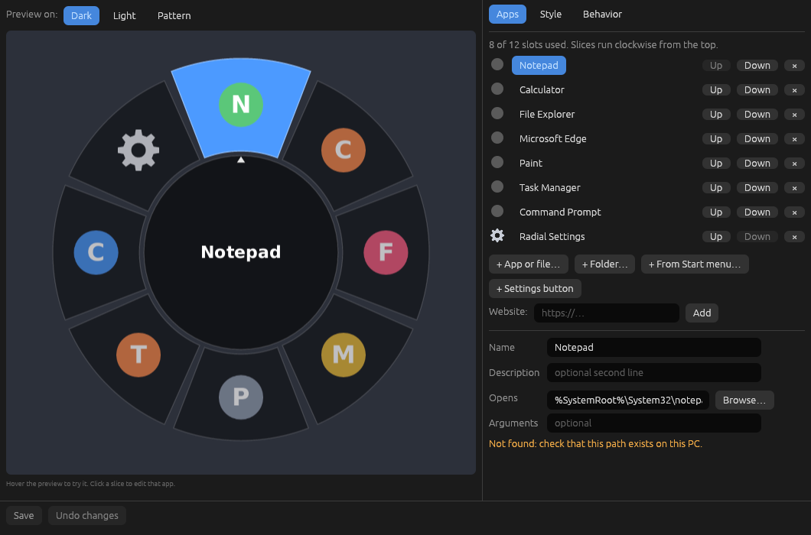
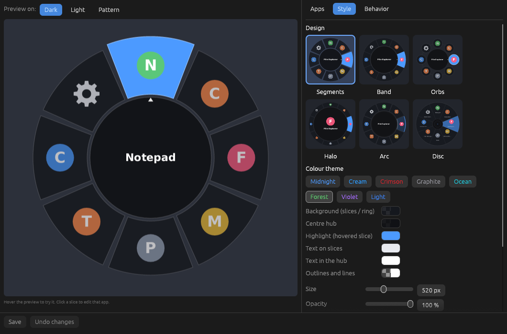

# Radial Launcher

A tiny always-running Windows app. **Hold Shift + Middle mouse button** and a game-style
wheel of your favourite apps, files and folders appears in the middle of the screen. Move
toward a slice and release to launch it. Everything is configured from a GUI — no config
file editing needed.



Top row: Segments, Band, Orbs. Bottom row: Halo, Arc, Disc (also in a cream theme: `docs/designs-cream.png`).

## Two programs, one folder

| File | Role | Always running? |
|---|---|---|
| `radial-launcher.exe` | Hook + wheel + tray icon | Yes (tiny) |
| `radial-settings.exe` | The settings GUI | **No** — opened on demand, closed when you are done |

Keep both exes **in the same folder**. Open the settings from the tray icon (**Settings…**) or
by adding the built-in **Radial Settings** slice (the gear) to the wheel. Saving applies
instantly to the running launcher; no restart.

## Use it

| Action | Result |
|---|---|
| Hold **Shift + Middle button** | Wheel opens in the centre of the monitor under the pointer |
| Move toward a slice, **release** | Launches it. Releasing over the centre hub cancels |
| **Quick tap** (shorter than the tap time) | Wheel stays open; **left-click** a slice to launch |
| **Right-click** or middle-click again | Cancel |

Tray menu: Settings, Enabled (pause the hook, e.g. before a game), Start with Windows,
Open config file, Reload config, Quit.

## The settings app

- **Apps** – up to 12 slices. Add from the Start menu list, pick any file or folder with the
  normal Windows dialog, set name, description and arguments, reorder or remove. Click a
  slice in the live preview to edit it.
- **Style** – six wheel designs (Segments, Band, Orbs, Halo, Arc, Disc), theme presets
  (Midnight, Cream, Crimson, Graphite, Ocean, Forest, Violet, Light), your own colours for
  background, hub, highlight, text and border, plus size, opacity, ring thickness, gap, icon
  and text scale. The preview is rendered by the same code as the real wheel (WYSIWYG).
- **Behavior** – where the wheel opens, tap time, animation, labels, start with Windows,
  bring-launched-apps-to-front, return pointer.




## Fixes in this version

- **Launched apps open behind other windows.** The launcher remembers the visible windows,
  grants foreground rights (`AllowSetForegroundWindow` plus a harmless synthetic F24 key
  press, the usual trick to unlock `SetForegroundWindow`), starts the program, then watches
  for ~4 s for new windows and raises the first one (`AttachThreadInput` + `SetForegroundWindow`,
  falling back to `SwitchToThisWindow`). Turn off under Behavior if you don't want it.
- **Pointer stays where you released.** The old "put the pointer back" behaviour is now an
  opt-in setting (`return_cursor`, default off).

## Memory

Goal: keep the always-on part as small as possible. Measures taken:

- **No icons in RAM.** Icons are extracted by the settings app (or by a short-lived
  `radial-launcher --refresh-icons` process) into `%LOCALAPPDATA%\RadialLauncher\icons.bin`.
  The launcher reads that file only while the wheel is open, and frees it on close.
- **No font loaded.** Text is drawn with Windows GDI (Segoe UI), so no font file sits in RAM.
- **Buffers freed on close**, and the working set is trimmed a few seconds after start and
  after every close or reload.
- **GUI is a separate exe**, so egui/OpenGL are never loaded unless you ask for them.

These are design choices, **not measured numbers**. I could not run Windows here, so check
Task Manager → Details → *Memory (private working set)*. Expect the launcher to idle in the
low single-digit MB, but verify on your machine. The settings app needs OpenGL 2+ (any normal
GPU driver; fine in a VM only with 3D acceleration) and uses far more RAM while open.

## Build

Easiest: push to GitHub, **Actions → build → Run workflow**, download the
`radial-launcher-windows` artifact (contains both exes).

Locally (Windows 10/11, Rust from https://rustup.rs, VS Build Tools "Desktop development with C++"):

```
cargo build --release -p radial-launcher
set CARGO_PROFILE_RELEASE_OPT_LEVEL=2
set CARGO_PROFILE_RELEASE_LTO=thin
cargo build --release -p radial-settings
```

Both land in `target\release\`. Put them in one folder. The exes are not code-signed, so
Chrome/SmartScreen may warn; choose Keep / More info → Run anyway.

## Config

`%APPDATA%\RadialLauncher\config.json` — normally edited by the GUI. Old v1 files are
migrated (`accent` becomes the highlight colour). `RADIAL_CONFIG_DIR` and `RADIAL_CACHE_DIR`
override the folders. Special item path `@settings` opens the settings app.

## Known limits

- The Win32 code was **type-checked, not run** (no Windows machine available while writing it).
  Treat the first run as a test and report anything odd.
- The mouse hook does not see input going to **elevated (admin) windows**; run the launcher
  as admin if you need the wheel over those.
- Esc is not swallowed; use right-click to cancel.
- Games using exclusive fullscreen may cover the overlay; borderless windowed works.

## Layout

```
crates/core      shared: config, colours, wheel rendering (tiny-skia), icon cache, Win32 helpers
crates/launcher  radial-launcher.exe (hook, overlay window, tray, focus fix)
crates/settings  radial-settings.exe (egui GUI)
cargo run -p radial-core --features fontdue-text --example preview -- out_dir [theme]
```
