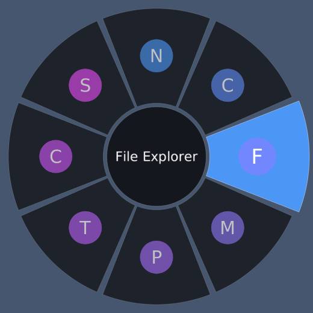

# Radial Launcher

A tiny always-running Windows app. **Hold Shift + Middle mouse button** and a game-style
wheel of your favourite apps appears in the middle of the screen. Move toward a slice and
release to launch it.



## Use it

| Action | Result |
|---|---|
| Hold **Shift + Middle button** | Wheel opens in the centre of the monitor under the pointer; pointer moves to the centre |
| Move toward a slice, **release** | Launches that app. Releasing over the centre hub cancels |
| **Quick tap** (< 250 ms) instead of holding | Wheel stays open; **left-click** a slice to launch |
| **Right-click**, **Esc**, or middle-click again | Cancel |

The tray icon menu has: Enabled (pause the hook, e.g. before a game), Start with Windows,
Edit config, Reload config, Quit.

## Build

You need Windows 10/11 and Rust (https://rustup.rs). The default MSVC toolchain also wants
the "Desktop development with C++" workload from Visual Studio Build Tools.

```
cargo build --release
```

The exe is `target\release\radial-launcher.exe`, a single file with no installer and no
runtime dependencies. Copy it anywhere and run it.

No local toolchain? Push this folder to GitHub and run the **build** workflow
(`.github/workflows/build.yml`); it uploads the exe as a downloadable artifact.

## Configure

Config lives in `%APPDATA%\RadialLauncher\config.json` and is created on first run
(tray menu: Edit config..., then Reload config).

```json
{
  "size": 520,
  "center": "screen",
  "restore_cursor": true,
  "accent": "#4C9AFF",
  "items": [
    { "name": "Notepad",    "path": "%SystemRoot%\\System32\\notepad.exe" },
    { "name": "Calculator", "path": "shell:AppsFolder\\Microsoft.WindowsCalculator_8wekyb3d8bbwe!App" },
    { "name": "My project", "path": "C:\\Program Files\\Microsoft VS Code\\Code.exe", "args": "\"D:\\work\\project\"" }
  ]
}
```

* `items`: 1 to 12 entries, clockwise from the top. `path` can be an .exe, .lnk, document,
  folder, URL, or `shell:AppsFolder\<AppUserModelID>` for Store apps (run
  `Get-StartApps` in PowerShell to list the IDs). `%ENV_VARS%` are expanded.
* `center`: `"screen"` (centre of the monitor, pointer is moved there and restored afterwards
  if `restore_cursor` is true) or `"cursor"` (wheel opens under the pointer).
* Icons are loaded from the app itself. If one can't be loaded, a coloured letter is used.

## Design notes (why it stays light)

* Idle = the UI thread blocks in `GetMessageW`; the hook thread blocks too. 0 % CPU.
* The mouse-hook callback only reads a few atomics and posts a message; all work happens on
  the UI thread, so the pointer never lags.
* The overlay is a layered, click-through, no-activate window drawn with software
  rendering (`tiny-skia`); no GPU, no browser engine, no framework.
* Render buffers are allocated when the wheel opens and freed when it closes. The font is
  loaded only while icons/labels are being built, then dropped.

## Known limitations

* Windows blocks hooks from seeing input over **elevated (admin) windows** unless this app is
  also run as administrator.
* The wheel can't draw over **exclusive-fullscreen** games (borderless-windowed is fine). Use the
  tray "Enabled" switch for games with strict anti-cheat.
* **Esc** is also delivered to the app under the wheel (keyboard input isn't intercepted);
  right-click cancels without side effects.
* Unsigned exes that install a global mouse hook can trigger antivirus heuristics.
* Only the platform-independent core (config, geometry, drawing) is covered by unit tests
  (`cargo test --lib`). The Win32 layer is type-checked but has not been run on a real
  Windows machine yet.

## Layout

```
src/lib.rs      platform-independent core (config, text, wheel geometry + drawing)
src/win/        Windows layer: hook.rs, mod.rs (overlay + lifecycle), tray.rs, icons.rs, autostart.rs
examples/       preview.rs renders the wheel to PNG on any OS
```
